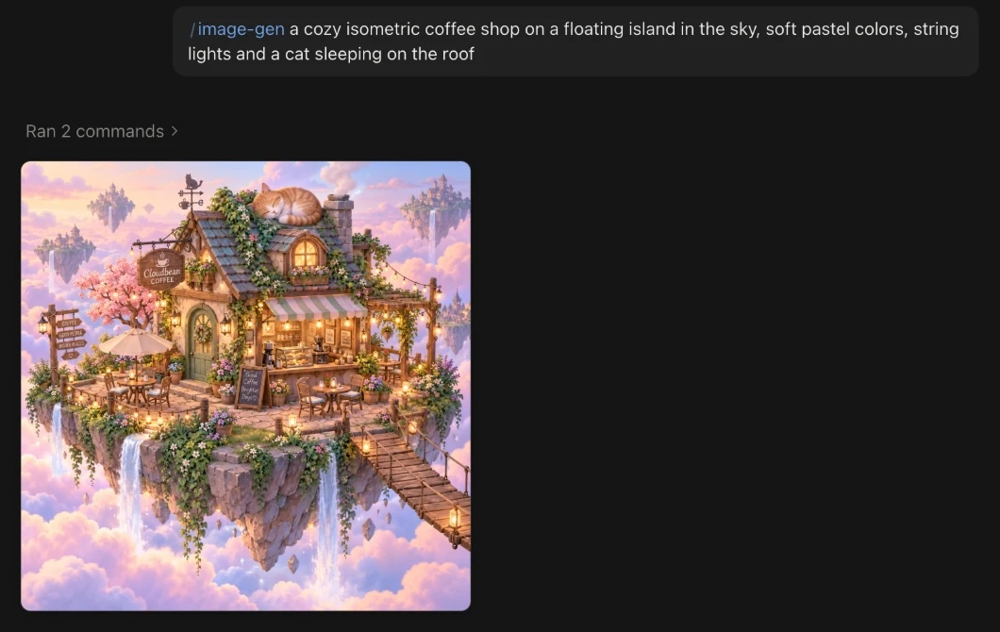
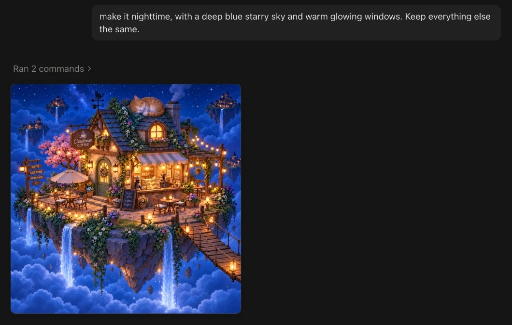
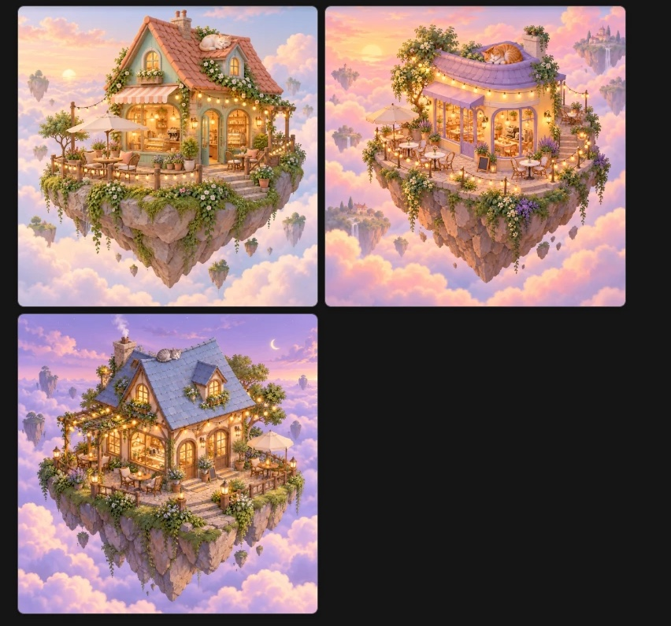
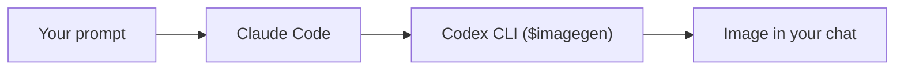

# image-gen

**Generate and edit images without leaving Claude Code.** A tiny skill that hands your
prompt to the [Codex CLI](https://github.com/openai/codex)'s built-in `$imagegen` and
shows the result right in your chat.

[](LICENSE)



- **No API key needed.** It uses your existing Codex login, such as your ChatGPT plan.
- **Edit by replying.** Say "make it nighttime" and Claude edits the last image.
- **Images right in the chat** in the Claude desktop app, clickable file paths in the terminal.

## Install

You need the [Codex CLI](https://github.com/openai/codex) installed and logged in
(`codex login`). Then run:

```bash
npx skills add mijatovicmilan/image-gen -g -a claude-code
```

Start a new Claude Code session and try it:

```
/image-gen a red apple on a white background
```

<details>
<summary><b>Let Claude install it for you</b></summary>

Paste this into Claude Code:

```
Install the image-gen skill by running:
npx skills add mijatovicmilan/image-gen -g -a claude-code -y
Then run `codex login status` and tell me if I still need to
install or log in to the Codex CLI.
```
</details>

<details>
<summary><b>Install as a Claude Code plugin instead</b></summary>

Choose **one** method, not both.

```bash
claude plugin marketplace add mijatovicmilan/image-gen
claude plugin install image-gen@image-gen
```

As a plugin, the command is `/image-gen:image-gen`.
</details>

## What you can do

### Edit by replying

No need to repeat the command. Ask for a change in the same conversation, and Claude
sends the previous image back to Codex together with your request.



### Explore variations

Ask for several takes at once, for example *"3 variations in mint, lavender and
twilight palettes"*.



### Edit your own images

Mention a file path and it's used as the image to edit or as a reference:

```
/image-gen make ~/Desktop/photo.png look like a watercolor painting
```

> [!TIP]
> You don't have to type the command at all. Asking Claude to *"generate an image of…"*
> or *"edit this image so…"* triggers the skill too.

## Prompts to try

```
/image-gen a minimalist app icon of a paper camera, orange and teal
/image-gen a flat hero illustration about remote work, warm colors
/image-gen redesign ./screenshot.png as a dark-mode UI
/image-gen a wide blog header of a lighthouse at dawn, watercolor
```

## Where images are saved

Images stay where Codex saves them, under `~/.codex/generated_images/`. Ask Claude to
copy them into your project if you need them there.

## FAQ

**Do I need an OpenAI API key?**
No. The skill uses whatever account the Codex CLI is logged in with. If you log in with
your ChatGPT account, images are covered by your ChatGPT plan.

**What does it cost?**
With a ChatGPT login, nothing extra: images count toward your plan's Codex usage limits.
If Codex is logged in with an API key instead, usage is billed to that key.

**Where are my prompts and images sent?**
To OpenAI, through Codex: your prompt and any image you ask to edit. Codex runs in a
read-only sandbox, so it can't change files in your project.

**Does it work on claude.ai or in the Claude mobile app?**
No. It needs Claude Code (desktop app, terminal or IDE extension) running on a computer
with the Codex CLI installed.

**Is this an official OpenAI or Anthropic project?**
No. It's an independent open-source skill.

## How it works



Claude passes your request to Codex unchanged. For edits, it attaches the image with
`--image`, so Codex works from the original instead of starting over.

The whole skill is one file: [`skills/image-gen/SKILL.md`](skills/image-gen/SKILL.md).
Tested with Codex CLI 0.163.0.

## Troubleshooting

<details>
<summary><b>"codex: command not found"</b></summary>

The Codex CLI isn't installed or isn't on your `PATH`. Install it from
[github.com/openai/codex](https://github.com/openai/codex), then open a new terminal.
</details>

<details>
<summary><b>"Not logged in" or no image comes back</b></summary>

Check your login with `codex login status`, and run `codex login` if needed. To see the
real error, run Codex by hand:

```bash
codex exec --skip-git-repo-check '$imagegen a red apple'
```
</details>

<details>
<summary><b>Claude doesn't recognize /image-gen</b></summary>

- Start a new Claude Code session after installing.
- Installed as a plugin? The command is `/image-gen:image-gen`, not `/image-gen`.
- Don't install both methods at once, or you'll have two copies of the skill.
</details>

## Update and uninstall

| | Plain skill | Plugin |
|---|---|---|
| **Update** | `npx skills update image-gen -g` | `claude plugin update image-gen@image-gen` |
| **Uninstall** | `npx skills remove image-gen -g` | `claude plugin uninstall image-gen@image-gen` |

## Contributing

Issues and pull requests are welcome. The skill lives in
[`skills/image-gen/SKILL.md`](skills/image-gen/SKILL.md), and the plugin metadata in
[`.claude-plugin/`](.claude-plugin/). To try the plugin version locally:

```bash
claude --plugin-dir .
```

## License

[MIT](LICENSE) © Milan Mijatovic

<sub>Not affiliated with OpenAI or Anthropic. Codex is a trademark of OpenAI; Claude is a trademark of Anthropic.</sub>
